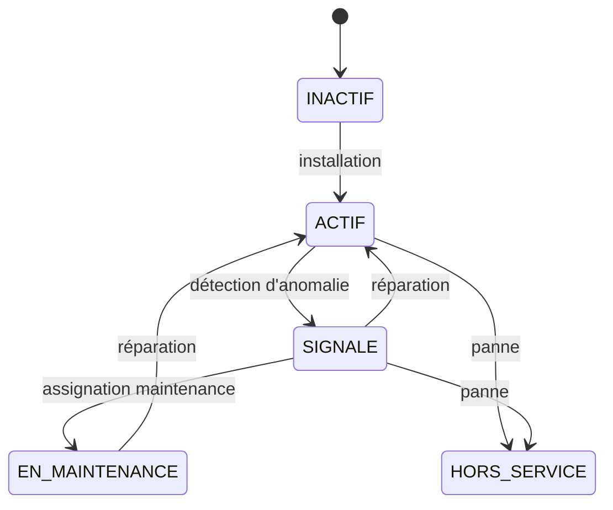
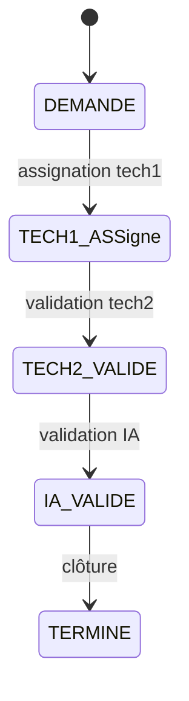
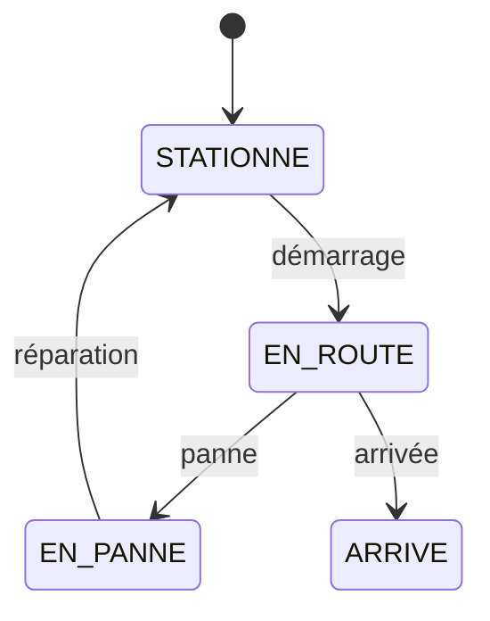

# Modélisation des automates

## Capteur

| État source | Événement | État cible | Action |
|---|---|---|---|
| INACTIF | installation | ACTIF | Activer la surveillance |
| ACTIF | détection d'anomalie | SIGNALE | Créer une demande |
| ACTIF | panne | HORS_SERVICE | Envoyer une alerte |
| SIGNALE | panne | HORS_SERVICE | Envoyer une alerte |
| SIGNALE | réparation | ACTIF | Fermer l'alerte |
| EN_MAINTENANCE | réparation | ACTIF | Remettre en service |

## Validation d'intervention

## Véhicule autonome

